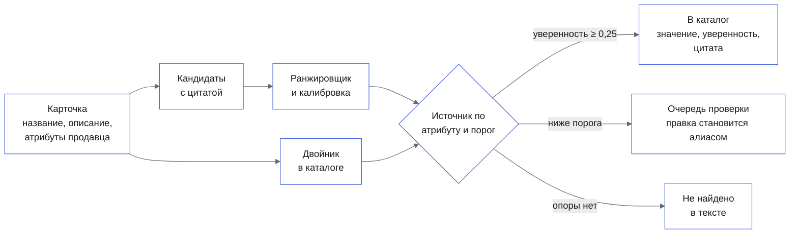

# Атрибуты товаров

Команда каталога маркетплейса вставляет карточку продавца и получает обязательные характеристики
в едином формате: значение, уверенность и место в тексте, откуда оно взято.

> **Значение попадает в карточку только с опорой: цитатой из текста карточки или ссылкой на
> двойника из каталога.** Кандидат без найденного в тексте фрагмента не создаётся
> (`test_candidates_carry_quotes_and_pick_expected_values` сверяет каждую цитату со срезом текста),
> decision-модель выбирает только из готовых вариантов, а значение ниже порога уверенности уходит
> человеку в очередь проверки, а не в каталог.

## Зачем это

Продавцы заполняют карточки неровно: в тестовой выборке обязательные атрибуты категории заполнены
в структурированных полях продавца только у **25,9%** пар «карточка × атрибут», остальное спрятано в
свободном тексте или отсутствует.
Незаполненный атрибут выводит товар из фильтров поиска. Прямой вызов LLM на каждую карточку дорог и
придумывает значения, которых в карточке нет.

На карточке «Смартфон HONOR 400 12+256Gb черный» пайплайн находит в тексте «256 ГБ», «6,55 дюйма» и
«6000 мАч», приводит их к формату каталога и отдаёт с уверенностью и цитатой. Чего в тексте нет —
поддержки стандартов и серии — он не заполняет, а помечает «Не найдено в тексте». На тестовой
выборке обязательные атрибуты заполнены у **79,0%** пар при точности **83,3%**.

## Как это работает



<table>
<tr>
<td valign="top" width="33%">

**1. Кандидаты с цитатой и калиброванный ранжировщик**

Справочники значений из эталона train, правила «число + единица» и «ключ: значение», словари брендов
и цветов находят кандидатов; у каждого есть фрагмент текста. CatBoost выбирает кандидата,
isotonic-калибровка превращает балл в вероятность.

<sub>ECE итоговой уверенности 0,021; при уверенности 0,9–1,0 точность 98,3%</sub>

</td>
<td valign="top" width="33%">

**2. Двойники в каталоге дают значения, которых нет в тексте**

Тот же товар часто уже лежит в каталоге с заполненными характеристиками. Поиск соседей по
символьным n-граммам названия с совпадением бренда и чисел переносит их в пустые слоты, со ссылкой на
SKU двойника и сходством.

<sub>+11,9 п. п. recall сверх потолка текста; точность переноса 76,2%</sub>

</td>
<td valign="top" width="33%">

**3. Источник выбирается по атрибуту, на валидации**

Для каждой пары «атрибут × известная или новая категория» на val выбран лучший источник: базлайн,
ранжировщик, двойник или decision-модель TypeSafe Jev, которая отвечает выбором из вариантов, а не
текстом. Test в выборе не участвует.

<sub>Правило зафиксировано до прогона на test</sub>

</td>
</tr>
</table>

## Попробовать за две минуты

После [запуска](#запуск) откройте интерфейс. Входа нет.

| | Что сделать | Что увидите |
|---|---|---|
| 1 | «Пример из тестовой выборки» → «Смартфон HONOR 400 12+256Gb черный» → «Извлечь атрибуты» | Таблица: бренд HONOR 99%, встроенная память 256 ГБ 100%, ёмкость аккумулятора 6000 мАч 99%, у каждого — источник и цитата, подсвеченная в тексте карточки |
| 2 | Посмотрите строку под таблицей | «Не найдено в тексте: Поддержка стандартов и Серия» — значений, которых нет в карточке, система не пишет |
| 3 | Пример «Смартфон Apple iPhone 16 Pro Max 512GB» → извлечь → в «Очереди проверки» исправьте «eSim» на «1 nano-SIM/1 eSim» | Повторное извлечение той же карточки возвращает «1 nano-SIM/1 eSim» с уверенностью 97% и источником «Подтверждено человеком» |

## Результаты

Оценка на 25 550 карточках test и восьми отложенных целиком категорий (191 236 пар «карточка ×
обязательный атрибут»), эталон — нормализованные параметры каталога `*_search`, которых нет во входе.
Правила, пороги и выбор источников подбирались только на val (24 084 карточки) и зафиксированы
до прогона на test; прогон 2026-10-15.

| Метрика | Сборка | Базлайн: справочники и правила | Порог из плана |
|---|---|---|---|
| Micro F1 по обязательным атрибутам | **77,5** | 66,8 | ≥ 0,5 |
| F1, взвешенный по трафику категорий | **80,6** | 76,4 | публикуется рядом с невзвешенным |
| Покрытие обязательных атрибутов | **79,0%** | 25,9% у продавцов, 69,1% у базлайна | не ниже покрытия у продавцов |
| Micro F1: хвост категорий / мелкие продавцы | **77,9 / 69,9** | 66,5 / 65,1 | не ниже всего набора больше чем на 15 п. п. |
| Смартфоны / ноутбуки, micro F1 | **85,0 / 82,5** | 68,1 / 69,6 | — |
| ECE итоговой уверенности | **0,021** | не калибрована | — |
| Стоимость Jev на 1 млн карточек | **≈ $62** | $0, без модели | публикуется рядом с выигрышем |

Стоимость Jev — сумма `usage.cost` по 8 000 карточкам выборки ($0,495), в модель ушли 28% слотов.

**Где проигрываем.** На восьми новых категориях сборка лишь возвращается к уровню базлайна: micro
F1 65,8 против 65,5, взвешенный 75,4 против 75,8. Атрибут «Модель» у смартфонов (83,3) и ноутбуков
(74,0) хуже базлайна (97,7 и 94,9), цвет ноутбуков хуже ранжировщика (58,2 против 69,3): двойники
переносят цвета других вариантов товара. Jev поверх ранжировщика F1 не поднимает (70,3 → 70,3 на
выборке), его вероятности переуверены (ECE 0,34).

<details>
<summary><b>Пересчитать все числа раздела</b></summary>
<br>

Из `backend/`, после подготовки данных (см. «Запуск»):

```bash
uv run baseline --data ../data/processed --out ../data/predictions --reports ../reports
uv run ranker --data ../data/processed --out ../data/predictions --reports ../reports
uv run twins --data ../data/processed --out ../data/predictions --reports ../reports
uv run final --data ../data/processed --out ../data/predictions --reports ../reports --model ../data/models/fusion
```

Без сети и платных ключей: Jev отвечает из кэша `data/decision_cache/` или пропускается. Отчёты
пишутся в `reports/` (`baseline.md`, `ranker.md`, `twins.md`, `final.md`). Сборка — около 20 минут
и 2,3 ГБ памяти, ранжировщик — около 20 минут и 3 ГБ.

</details>

## Запуск

Нужны [uv](https://docs.astral.sh/uv/) и Node.js 22.18+. Из корня, после подготовки данных (ниже):

```bash
cd backend && uv run stand-pack --data ../data/processed --out ../data/stand/pack.json.gz
STAND_PACK=../data/stand/pack.json.gz uv run uvicorn app.main:create_app --factory
```

Во втором терминале:

```bash
cd frontend && npm ci && npm run dev
```

Интерфейс — адрес из вывода Vite, API — http://localhost:8000, Swagger — http://localhost:8000/docs.
`backend/Dockerfile` и `frontend/Dockerfile` собирают образы тех же сервисов.
Пакет стенда (~2 МБ) собирается из подготовленных данных за ~2 минуты; без него страница показывает
ошибку с подсказкой собрать пакет. Ключи не нужны.

**Данные.** Архив организаторов `dataset.zip` (1,1 ГБ) в git не хранится. SHA-256:
`28758293f1174b2f19adcf2c99a86a9b5d2094aa22f3bbc92538af7180b59043`.

```bash
sha256sum dataset.zip
unzip dataset.zip -d data/raw
cd backend
uv run prepare-data --raw ../data/raw --out ../data/processed
```

Подготовка — около 11 минут и 5,2 ГБ памяти, без сети.

<details>
<summary><b>Файл предсказаний по всем карточкам, проверки, переменные</b></summary>
<br>

Файл предсказаний по всем 1 177 200 карточкам (`data/predictions/final_all.predictions.jsonl`): сначала
категории для карточек вне каталога, затем ступени сборки, перенос двойников и шардированный прогон,
не больше трёх процессов одновременно. Итог: 3,58 атрибута на карточку, у 11,2% карточек нет ни одного
атрибута, 14,6% значений перенесены от двойников:

```bash
cd backend
uv run infer-categories --data ../data/processed --raw ../data/raw --reports ../reports
STAGE=final WORK=../data/fusion_shards bash scripts/predict-all.sh ../data/processed ../data/predictions
```

`STAGE=final` требует сохранённых моделей ранжировщика и сборки. Формат строки:
`{sku_id, category_id, split, confidence_calibrated, attributes: {атрибут: {value, confidence, source,
evidence, start, end}}, review}`.

Проверки: `cd backend && uv run ruff check . && uv run mypy . && uv run pytest tests/unit`;
`cd frontend && npm run verify`. Decision-модель необязательна: `DECISION_MODEL=system_one`,
`DECISION_MODEL_URL=https://openrouter.ai/api`, `DECISION_MODEL_NAME=typesafe/jev-1.13`,
`DECISION_MODEL_API_KEY`.

</details>

## Устройство

Стенд — React-страница и FastAPI-бэкенд; пайплайн извлечения — те же модули Python, что и офлайн-команды.
Ключевое решение — выбор источника значения и порог уверенности — принимает сборка
(`backend/src/app/domain/fusion.py`) по правилу, подобранному на val.

Разведочный анализ данных — [`notebooks/eda.ipynb`](notebooks/eda.ipynb): поля, пропуски, распределения, длинный хвост, связка файлов.

## Ограничения

- **Эталон — параметры каталога `*_search`, а не разметка людьми.** Организаторы обещали размеченную
  часть, в архиве её нет; метрики меряют совпадение с нормализованными фильтрами каталога, а
  ошибки самого каталога считаются ошибками решения.
- **Новые категории — на уровне базлайна.** На восьми отложенных категориях micro F1 65,8 против
  65,5 у правил: у ранжировщика нет частот значений, двойников в индексе нет по построению.
- **Карточки вне каталога не оценены.** Категория для 697 тыс. таких карточек восстановлена
  классификатором (на test top-1 98,1%), но точность категорий и атрибутов на них не измерена:
  эталона нет. Очередь проверки стенда хранится в памяти процесса и сбрасывается при перезапуске.

Команда GoatWhistle, продуктовый хакатон «Точка сборки», 2026.
