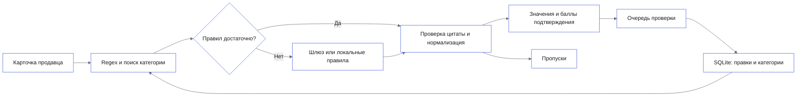

# Как обрабатывается карточка

Backend получает название, описание и параметры продавца. Регулярные выражения
находят значения, а TF-IDF ищет близкие категории и их схемы. Шлюз получает
карточку, кандидатов и компактную JSON-схему с идентификаторами полей,
если результат правил не прошёл [условия достаточности](model-routing.md).

Без ключа работает локальный обработчик правил. Пустое или неподтверждённое поле
остаётся пропуском. Для новой категории создаются схема и поля с цитатами;
они сохраняются в SQLite и участвуют в последующем поиске.

После записи категории поиск, режим `rules` и список категорий читают общий
актуальный снимок схем. Новая категория и добавленные поля доступны сразу,
без перезапуска. `rules` строит профиль выбранной категории отдельно: одинаковые
названия полей с разными единицами в других категориях не подменяют его схему.
Кэш словарей учитывает и схему, и ручные исправления. После перезапуска снимок
восстанавливается из SQLite. Это механизм одного процесса; несколько работников
потребуют отдельного согласования изменений каталога.

Слои backend: `domain` — значения и проверки, `usecase` — сценарии,
`repository` — хранение и поиск, `adapter` — шлюз, `controller` — HTTP.
Зависимости собираются в [main.py](../backend/src/app/main.py).

Сетевые запросы и SQLite асинхронные. CPU-вычисления поиска вынесены из цикла
обработки запросов. Очередь ограничена, ожидание входит в таймаут запроса.
Тип сетевого сбоя сохраняется через адаптер и сценарий до API: таймаут,
перегрузка сервиса, недоступность и неверный ответ имеют отдельные коды.
Тело ответа провайдера, адрес запроса и ключ не передаются пользователю.

Пакетный API использует те же сценарии и хранение, что и одиночный. Перед
формированием групп отбираются карточки, полностью разобранные правилами.
Оставшиеся группируются по числу карточек и размеру JSON, затем обрабатываются
ограниченным числом задач. Каждый результат валидируется по своей карточке,
сохраняется в историю и сопоставляется с исходным ID.

Порог применяется после валидации. Автоматическое принятие хранится отдельно
от решения человека, не создаёт обучающий алиас и не мешает последующей правке.
[Подробности и измерения](scaling.md).

Compose поднимает подготовку тома, миграции, загрузку начальных данных, API
и интерфейс. Постоянные данные находятся в именованном томе `state`.
Проверка готовности API выполняется после загрузки каталога.

[Документация](README.md)
